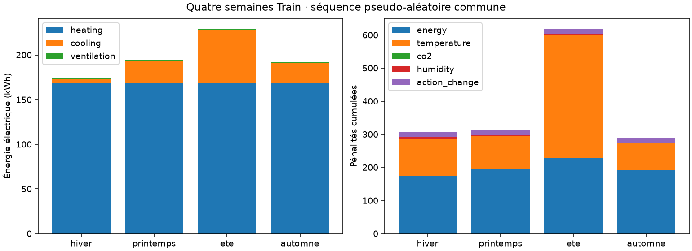
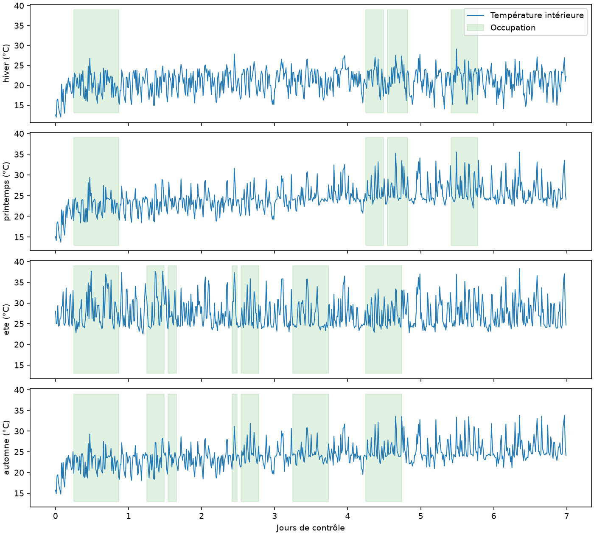

# Qualification du MDP

**38.8.4 — Logiciel.** Les 106 tests unitaires sont passés dans Docker.
Les vérificateurs Gymnasium et Stable-Baselines3 passent sur le MDP
avec les doubles. Gymnasium conserve trois avertissements secondaires
sur les bornes infinies du Box et l’absence d’EnvSpec. SB3 ne signale
aucun avertissement.

**38.8.5 — Physique.** Quatre épisodes saisonniers Train et un rejeu
hivernal ont produit 3 360 transitions contrôlées et 3 365 observations.
Chaque épisode a couvert les 27 actions, pendant 672 pas avec sept jours
préparatoires. Les cinq fins ont été naturelles, avec code moteur zéro.
Aucun avertissement ni erreur EnergyPlus, et aucune anomalie P1 ou P2.

Les départs Train sont les 27/01, 28/04, 07/08 et 09/10. L’occupation est
dynamique, seed 42. La seed 3885 génère une séquence commune d’actions
pseudo-aléatoires qui couvre chaque combinaison 24 ou 25 fois. Les
résultats ci-dessous caractérisent cette séquence de qualification.
Les performances RBC/PPO restent à établir.

## Physique et confort

| Saison | Pas | Total / chauffage / DX / ventilation (kWh) | Température min / moy / max (°C) | Heures occupées | Thermique hors plage tous pas / occupés (%) | CO₂ moyen total / occupé (ppm) | CO₂ > 1000 occupé (%) | HR moyenne totale / occupée (%) | HR hors plage occupée (%) | Avertissements / erreurs |
|---|---:|---|---|---:|---|---|---:|---|---:|---|
| Hiver | 672 | 174.81/168.50/4.82/1.49 | 11.971 / 20.882 / 29.112 | 37 | 17.11 / 67.57 | 509.5 / 755.3 | 4.05 | 29.06 / 36.03 | 73.65 | 0 / 0 |
| Printemps | 672 | 194.42/168.50/24.43/1.49 | 13.731 / 24.479 / 35.524 | 37 | 17.41 / 34.46 | 518.0 / 779.8 | 5.41 | 34.72 / 37.90 | 62.84 | 0 / 0 |
| Été | 672 | 229.42/168.50/59.43/1.49 | 22.490 / 27.557 / 38.283 | 56 | 43.75 / 56.25 | 560.2 / 776.0 | 4.46 | 39.63 / 41.10 | 38.39 | 0 / 0 |
| Automne | 672 | 192.07/168.50/22.08/1.49 | 14.786 / 24.271 / 33.829 | 56 | 15.62 / 24.11 | 556.8 / 764.6 | 3.12 | 39.17 / 43.06 | 35.27 | 0 / 0 |


## Récompense et contributions cumulées

| Saison | Récompense cumulée | Min / moy / max | Énergie | Température | CO₂ | HR | Changement d’action |
|---|---:|---|---:|---:|---:|---:|---:|
| Hiver | -305.879 | -3.813 / -0.455 / -0.008 | 174.813 | 109.268 | 0.591 | 6.141 | 15.067 |
| Printemps | -313.713 | -5.893 / -0.467 / -0.005 | 194.421 | 100.136 | 1.288 | 2.801 | 15.067 |
| Été | -618.914 | -7.569 / -0.921 / -0.010 | 229.419 | 370.287 | 1.350 | 2.791 | 15.067 |
| Automne | -289.858 | -4.838 / -0.431 / -0.005 | 192.073 | 79.775 | 1.150 | 1.793 | 15.067 |


## Accords avec les références

Le vecteur reconstruit à partir des mesures brutes et du CSV est identique
après conversion en `float32`. L’écart électrique maximal au compteur
natif est de **4,66 × 10⁻¹⁰ J**. L’écart maximal avec le calcul indépendant
de la récompense est de **8,88 × 10⁻¹⁶**. Les rapprochements API/CSV
appliquent les tolérances historiques de `1e-6` en absolu et `1e-9` en relatif.
La moyenne intérieure de l’état est vérifiée sur les sous-pas pondérés.
Le rapport de fin de zone du CSV est rapproché de la mesure homologue.

Le rejeu hivernal est identique octet pour octet pour les observations et
récompenses, les sous-pas, les commandes, les prédictions DX et le CSV natif.
Les deux graphiques sont des exports synthétiques de la 38.8.5.





## Limites d’interprétation

- La météo provient d’un seul fichier TMYx. Le découpage sépare les jours de cette série.
- L’occupation dynamique est synthétique et non calibrée. Les fenêtres au sein d’un même ensemble peuvent se chevaucher et ne constituent pas des échantillons indépendants.
- Les coefficients de la récompense sont validés comme convention de départ. Leur calibration par apprentissage ou par sensibilité reste à étudier.
- L’humidité est observée sans actionneur indépendant. Les hypothèses de ventilation restent à calibrer et la consigne de Cooling est provisoire. [Autres limites physiques et de cycle de vie](sinergym-architecture.md#limites)

## Reproduire la qualification

Préparer l’EPW local et la fonction `eb` du [guide Docker](sinergym-usage.md#commandes-docker-et-chemins).
Le fichier courant est monté en lecture seule dans le conteneur. Les deux
commandes de qualification ci-dessous créent des sous-dossiers neufs sous
le montage de résultats et conservent les données brutes localement.

```bash
eb python -m unittest discover -s tests/unit -v

run=$(mktemp -d "$repo/simulation-outputs/sinergym-runs/mdp-XXXXXX")
out="/project/simulation-outputs/sinergym-runs/${run##*/}"
eb python scripts/validation/run_mdp_qualification.py "$out/episodes"
eb python scripts/validation/check_mdp_qualification.py "$out/episodes" --report-dir "$out/report"
```

Le premier outil vérifie les départs et la seed d’occupation dans Train,
puis conserve manifestes, actions et mesures. Les demandes supplémentaires
de reporting s’appliquent uniquement aux copies de modèle. Le second outil
vérifie les traces, recalcule la récompense indépendamment et génère les
statistiques et graphiques sans lancer EnergyPlus. Seuls les tableaux et
figures synthétiques sont proposés au versionnement.
