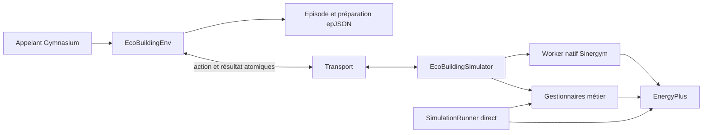
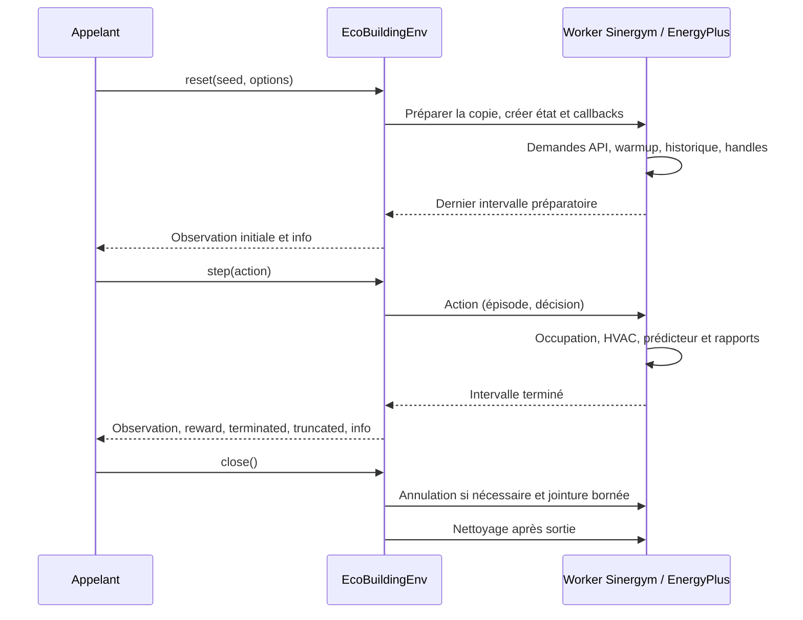

# Architecture EcoBuilding–Sinergym

Le moteur EnergyPlus calcule la physique du bureau. Sinergym fournit le worker EnergyPlus et ses points d’interaction. Gymnasium définit le contrat de la façade. Stable-Baselines3 fournit un checker logiciel utilisé dans les tests. Le projet vise ensuite le contrôle par apprentissage et la coordination multi-agent.

- `EcoBuildingEnv` construit les espaces, gère reset/step/close et projette le dernier instantané physique.
- `EcoBuildingSimulator` hérite de `EnergyPlus.start()` de Sinergym. Il orchestre les callbacks et protège le nettoyage de l’état par jointure préalable du worker.
- `Transport` associe action et résultat par identifiants d’épisode et de décision. Chaque canal a un emplacement. Publication atomique et instantané détaché sous contrôle d’une condition de synchronisation. La première erreur est conservée et prioritaire sur les résultats en attente.
- `Episode` et `prepare_episode_inputs` valident le calendrier et préparent une copie physique inchangée hors champs autorisés du RunPeriod et ajout éventuel du compteur CSV. EnergyPlus ouvre l’EPW d’origine. Aucun DDY n’est requis.
- `HVACController` valide et écrit le vecteur. `CoolingCommand` synchronise la vitesse effective selon la demande du prédicteur. `OccupancyManager` applique l’occupation exogène. `ObservationManager` collecte, intègre et valide les observations. `SimulationRunner` réutilise ces gestionnaires en accès direct pour les références.

## Cycle et contrat temporel

Le démarrage natif alloue l’état, enregistre les quatre callbacks spécialisés, puis les callbacks natifs de progression, de warmup et les trois rappels de fin de zone. `make_eplus_args()` demande les variables sur cet état avant le lancement du worker. Le warmup et l’historique s’exécutent avec les commandes natives. Au dernier intervalle préparatoire, lorsque les données sont disponibles, les handles sont résolus. En fin de zone, la première observation est publiée puis le callback d’action attend la décision 0.

| Phase EnergyPlus | Traitement |
|---|---|
| Avant météo de zone | Appliquer l’occupation exogène du prochain intervalle contrôlé. |
| Avant bilan thermique | Appliquer le vecteur HVAC demandé pour cet intervalle. |
| Après prédicteur et gestionnaires HVAC | Synchroniser la commande DX selon la charge. |
| Après rapport système | Collecter chaque sous-pas HVAC finalisé. |
| Après rapport de zone | Dans les hooks Sinergym redéfinis, finaliser et publier l’intervalle, puis attendre la prochaine action. Le hook de contexte est vide. |

Chaque action contrôle 900 s, soit 96 transitions par jour et 672 par semaine. Une trajectoire comporte une observation de plus que le nombre de transitions. L’amorçage, à la fin des sept jours préparatoires par défaut, ne contribue pas au bilan contrôlé. L’occupation observable décrit le dernier intervalle terminé. Un changement d’occupation peut donc apparaître avec un décalage d’un pas vu de la décision. Le profil futur reste interne.

La dernière transition attend la sortie naturelle du worker et son code zéro. `close()` réveille les côtés bloqués et attend la fin du worker avant de détacher les gestionnaires, d’effacer les callbacks et de détruire l’état. Un worker encore actif après délai conserve son état et empêche un reset. Les erreurs remontent avec leur cause lorsqu’elle est disponible. Le calendrier est à quatre pas par heure, sans DST ni année imposée. Les fenêtres traversant une année ou un jour intercalaire potentiel sont rejetées.

## Contrat Gymnasium provisoire

`MultiDiscrete([3, 3, 3])` dans l’ordre Heating, Cooling, Ventilation. Les 27 vecteurs OFF (0), MEDIUM (1), HIGH (2) sont admissibles sans restriction horaire ou saisonnière. Le chauffage et le Cooling peuvent être demandés simultanément. L’activation DX dépend ensuite de la charge.

Le Box non borné projette en `float32` cinq valeurs par défaut, dans cet ordre.

| Champ | Unité et convention |
|---|---|
| `indoor.indoor_c` | °C, variable EnergyPlus *Zone Mean Air Temperature* lue au rapport de fin de zone. |
| `indoor.indoor_rh_pct` | %, humidité relative de fin d’intervalle. |
| `indoor.co2_ppm` | ppm, concentration de fin d’intervalle. |
| `occupancy.people` | Personnes, effectif de l’intervalle terminé. |
| `energy.total_j` | J, somme électrique sur l’intervalle. |

`info` contient les horodatages, actions demandées et appliquées et l’instantané physique complet, dont les diagnostics et les moyennes pondérées RH/CO₂ sur les sous-pas. `reward = 0.0` sert aux vérifications de contrat. `terminated` vaut False. `truncated` vaut True seulement à la fin naturelle confirmée. Un timeout ou un échec technique lève une exception.

## Bureau et énergie

Bureau de 5 × 4 × 3 m, 20 m², 60 m³, fenêtre sud, porte nord, infiltration continue de 0,2 ACH, météo de Belfort–Fontaine. La résistance électrique fournit 0/1 000/2 000 W. Le DX a deux vitesses actives de 1,5 et 3,5 kW frigorifiques nominaux. La capacité effective dépend des conditions de fonctionnement et peut dépasser la valeur nominale. La consigne technique qualifiée est 25 °C. La ventilation équilibrée commande 0/40/120 m³/h, soit environ 0/6,67/20 W au total, en supposant 150 Pa par ventilateur et un rendement de 50 %. L’air neuf de ventilation, l’infiltration et l’air recirculé par le DX sont distincts.

L’occupation native représente deux personnes les jours ouvrés de 08:00 à 12:00 et de 13:00 à 18:00, zéro en dehors. Les profils dynamiques représentent zéro, une ou deux personnes, avec présence possible en dehors de ces horaires. Les commandes HVAC suivent le même contrat quelle que soit l’occupation. [Modèle physique](../models/README.md)

Le bilan opérationnel additionne le chauffage électrique, la consommation du système DX avec son ventilateur, et la ventilation mécanique. Le chauffage est lu en joules de zone et vérifié contre l’intégrale de puissance. L’électricité DX est intégrée en W × secondes sur les sous-pas HVAC finalisés. La ventilation somme l’énergie de ses sous-pas finalisés. `E_kWh = E_J / 3 600 000`. La puissance moyenne vaut `E_J / 900`. Le handle API `Electricity:Facility` reste indisponible par la méthode standard qualifiée. Le compteur natif CSV sert de référence indépendante, sans index interne codé en dur. Les campagnes historiques ont vérifié la somme des trois postes contre ce compteur. Tout nouveau consommateur demande une extension explicite du bilan. [Conventions métier](architecture.md)

## Limites

- Les interfaces privées de Sinergym 3.12.2 et l’ordre des callbacks sont sensibles aux changements de version. Limiter l’usage qualifié à une simulation active par processus. La jointure du worker précède toujours la destruction de son état.
- La RSS a progressé de 291 à 458 MiB (pic 553) lors des resets hebdomadaires et de 290 à 433 MiB (pic 528) lors des interruptions. La durée de ces campagnes ne permet pas de conclure à une fuite. Un thread OS supplémentaire a été relevé ponctuellement lors de T03-B-1. Le rejeu ciblé est revenu au niveau de référence.
- La sortie moteur non nulle après la dernière publication a été qualifiée sur doubles. La projection reste non bornée et la façade n’a pas d’EnvSpec.
- Les profils d’occupation dynamiques et l’hypothèse de ventilation ne sont pas calibrés sur des mesures réelles. La consigne Cooling reste provisoire. L’humidité est observée. La commande active d’humidité, des fenêtres, des portes et des volets reste à qualifier.
- Le MDP, une RBC officielle qualifiée, un PPO entraîné sur cette façade et la coordination MARL restent des travaux futurs.
